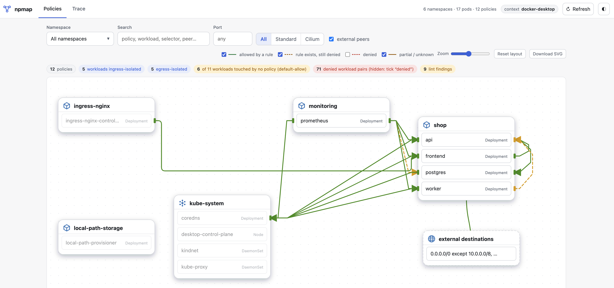
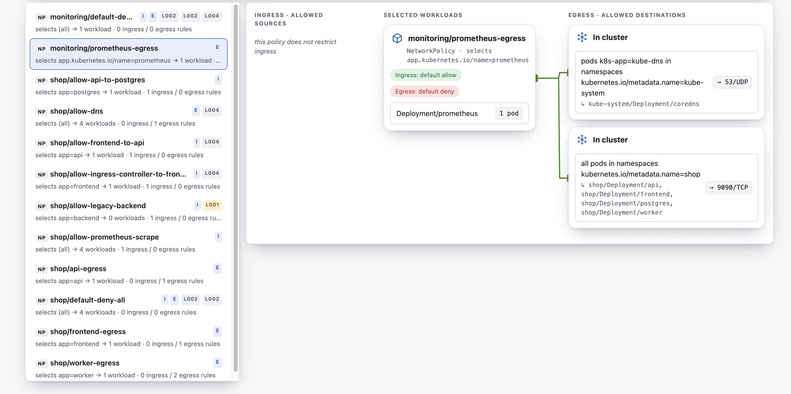
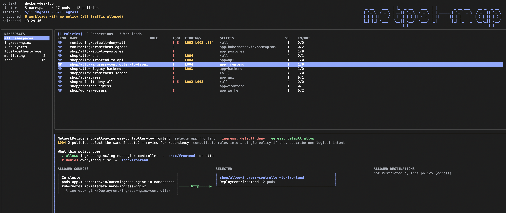

# kubectl-npmap







`kubectl npmap` is a NetworkPolicy viewer for Kubernetes. It reads the standard
`NetworkPolicy` and Cilium `CiliumNetworkPolicy` /
`CiliumClusterwideNetworkPolicy` objects in a cluster and shows, on a map and
in the terminal, **what they allow, what they deny, and why A can't reach B**.
It never changes the cluster.

## What it does

- **Policies map** (UI): every policy in the cluster on one map. Workloads
  grouped by namespace, badges for ingress/egress isolation, green edges for
  what rules allow, red for what is denied, amber where a rule exists but the
  connection is still blocked. Select a policy to see it the way an editor
  would: allowed sources, selected workloads, allowed destinations, ports, and
  each peer resolved to the real workloads it matches.
- **Trace** (`path`, also in both UIs): walks one connection layer by layer
  and names the first layer that breaks: DNS egress, DNS, Service endpoints,
  port mapping, NetworkPolicy, service mesh. Works for a Service, a workload,
  or the internet.
- **Terminal UI** (`tui`): the policy list, the connections and the detail
  views as a full-screen terminal app, for hosts without a browser.
- **Reachability matrix** (CLI): all workload-to-workload verdicts with the
  policy responsible for each, as a table, JSON, Mermaid, DOT or HTML report.
- **Diff** (CLI): what a proposed policy manifest would change, usable as a
  CI gate.
- **Lint** (CLI, and badges in the UI): stale selectors, deny-all baselines,
  allow-from-anywhere rules.

## Install

With Go 1.26:

```sh
go install github.com/aganet/kubectl-npmap/cmd/kubectl-npmap@latest
export PATH="$PATH:$(go env GOPATH)/bin"   # kubectl finds plugins on the PATH; add this to your shell profile
kubectl npmap --version
```

Or a binary from the [releases](https://github.com/aganet/kubectl-npmap/releases)
(macOS, Linux, Windows; amd64 and arm64). Any `kubectl-npmap` on your `PATH`
becomes `kubectl npmap`:

```sh
V=0.1.0; OS=darwin; ARCH=arm64      # or linux / windows, amd64 / arm64
curl -LO https://github.com/aganet/kubectl-npmap/releases/download/v$V/kubectl-npmap_${V}_${OS}_${ARCH}.tar.gz
curl -LO https://github.com/aganet/kubectl-npmap/releases/download/v$V/checksums.txt
shasum -a 256 --check --ignore-missing checksums.txt   # sha256sum on Linux
tar -xzf kubectl-npmap_${V}_${OS}_${ARCH}.tar.gz
sudo install -m 0755 kubectl-npmap /usr/local/bin/kubectl-npmap
kubectl npmap --version
```

A kubeconfig is all it needs. The usual kubectl flags (`--kubeconfig`,
`--context`, `-n`, `--as`) work on every command.

## Quick start

```sh
kubectl npmap ui                                          # open the web UI (localhost only)
kubectl npmap tui                                         # the same in the terminal, full screen
kubectl npmap path shop/frontend api.payments.svc:8080     # why can't frontend reach api?
kubectl npmap path shop/worker internet                   # can worker reach the internet?
kubectl npmap -A --denies-only                            # every denied edge in the cluster
kubectl npmap diff -f new-policy.yaml -A --fail-on-change # CI gate for policy changes
kubectl npmap lint -A                                     # audit the policies
```

`demo/demo.yaml` is a small three-tier app with the policies most teams use
(default-deny, DNS allow, tier-to-tier allows, Prometheus scrape, internet
egress with private ranges excluded). Its header lists the expected verdict
for each command, so it doubles as a tutorial:

```sh
kubectl apply -f demo/demo.yaml
kubectl npmap path shop/frontend shop/api:8080            # REACHABLE
kubectl npmap path shop/frontend shop/postgres:5432       # BLOCKED at NetworkPolicy
kubectl delete -f demo/demo.yaml
```

## Commands

```text
kubectl npmap [flags]                       reachability matrix (default command)
kubectl npmap path <source> <destination>   trace one connection layer by layer
kubectl npmap ui                            web UI on localhost
kubectl npmap tui                           full-screen terminal UI
kubectl npmap diff -f <policy.yaml>         impact of a proposed policy change
kubectl npmap lint                          audit policies for risky patterns
kubectl npmap --version                     installed version
```

| Command | Flags |
| --- | --- |
| matrix | `-n` namespace, `-A` all namespaces, `--from`/`--to` label selectors, `--from-namespace`/`--to-namespace`, `--port`, `--by workload\|pod`, `--denies-only`, `--show-allowed`, `--expand-edges`, `--full-why`, `--resolve-fqdn`, `-v`, `-o table\|json\|mermaid\|dot\|html` |
| `path` | `--port` (number or Service port name, same as a `:port` suffix), `--resolve-fqdn`, `--fail-on-block` (exit 2 when BLOCKED), `-o table\|json` |
| `ui` | `--listen` (default `127.0.0.1:8471`), `--no-open` |
| `tui` | none; press `?` inside for the keys |
| `diff` | `-f` manifest (multi-document YAML, standard or Cilium), `-A`, `--port`, `--by`, `--fail-on-change` (exit 2 when any edge changes), `-o table\|json` |
| `lint` | `-A`, `-o table\|json` |

Every command accepts the standard kubectl flags: `--kubeconfig`, `--context`,
`--namespace`/`-n`, `--as`, `--as-group`, `--request-timeout`.

A `path` reference is one of `ns/pod`, `ns/workload`, `ns/service[:port]`,
`service.ns.svc[.cluster.local][:port]`, `ns:key=value`, a bare name in the
current namespace, or an external target: `internet`, a host name, an IP or a
CIDR.

## Trace: why can't A talk to B?

```text
$ kubectl npmap path shop/frontend api.payments.svc.cluster.local:8080
Path: shop/frontend  →  api.payments.svc.cluster.local:8080
  source       2 pod(s): shop/frontend-7bbc848c96-448gv, shop/frontend-7bbc848c96-9kq2d
  destination  Service payments/api → 2 pod(s): payments/api-55f4856d6d-lcl2r, payments/api-55f4856d6d-x7m4p

  ✓ DNS egress     source may reach kube-system/kube-dns:53 — egress allowed by shop/frontend-egress
  ✓ DNS            api.payments.svc → Service payments/api (ClusterIP 10.96.12.4)
  ✓ Service        selector app=api matches 3 pod(s), 2 ready
                   api-55f4856d6d-b2zr8  CrashLoopBackOff (container api, 12 restarts)
  ✗ Port           8080/TCP (http) → targetPort http: no container port named "http" on any of the 2 pod(s)
  ✓ NetworkPolicy  ALLOW :8000 — ingress allowed by payments/allow-frontend; egress allowed by shop/frontend-egress
  – Mesh           no Istio/Linkerd sidecar on either side

  Verdict: BLOCKED at Port

  How to fix (Port):
  name a container port "http" in the pod spec, or point targetPort at a number; the pods declare container ports 8000
```

| Layer | What is checked |
| --- | --- |
| DNS egress | the source may reach `kube-system/kube-dns:53` under its policies |
| DNS | the name maps to a Service; a wrong namespace gets a *did you mean* |
| Service | selector → pods → Ready pods, with a diagnosis per unready pod |
| Port | Service port → `targetPort` → container port, named ports resolved |
| NetworkPolicy | standard + Cilium verdict at the pod port, with the deciding policies |
| Mesh | Istio mTLS STRICT against a sidecar-less source; other mesh policies flagged |

For external targets (`internet`, a host, an IP or a CIDR) the chain is DNS
egress → Egress policy → Mesh, where the Egress policy layer checks
`ipBlock`, Cilium `toEntities`, `toCIDR` and `toFQDNs`; `--resolve-fqdn`
resolves a host from your machine so CIDR rules can be matched. The check is
static and assumes outbound NAT. `--fail-on-block` exits 2 when blocked;
`-o json` gives one entry per layer.

## Web UI

`kubectl npmap ui` serves `http://127.0.0.1:8471` on your machine only.

- **Policies**: the map described above, with namespace, port and edge-type
  filters, search, zoom, draggable namespace groups and SVG export; a table of
  the connections drawn with a Trace button per row; a coverage bar counting
  the workloads no policy touches; and lint findings shown as badges on the
  policies they concern.
- **Trace**: source and destination picked from dropdowns filled with the
  cluster's namespaces, workloads, Services and ports; shows the equivalent
  CLI command. Clicking an edge on the map lands here.

## Terminal UI

`kubectl npmap tui` is the same thing for a terminal, for jump hosts and SSH
sessions, in the style of k9s:

- **Header**: cluster facts (namespaces, pods, policies, how many workloads
  are isolated, how many no policy touches, refresh time) and the logo.
- **Namespaces** on the left, with the number of policies in each.
- **Policies** (`1`), **Connections** (`2`) or **Workloads** (`3`) of the
  selected namespace in the middle, as tables with headers. Policies show
  kind, isolation, lint codes, selector and rule counts; connections show
  `source ──▶ destination`, the verdict and the deciding policy, with denied
  pairs hidden until you press `d`; workloads show pods, isolation, how many
  policies select them and which policies name them as a peer.
- **Detail** below. For a policy: a "What this policy does" list, one line per
  connection it creates (`✓ allows shop/frontend → shop/api on port http`,
  `✗ denies everything else → shop/api`), then the editor layout, allowed
  sources → selected workloads → allowed destinations, with one arrow per rule
  carrying its ports; `y` switches to the policy's YAML. For a connection,
  `enter` runs the layered trace, same output as `path`. For a workload, the
  policies that select it and name it, and `enter` jumps to its connections.
- **Trace anything** with `t`: pick a source workload, then a destination
  (Service, workload, the internet or a host named in a policy), optionally a
  port, and the trace appears in the detail pane.

Keys: arrows or `j`/`k`, `tab` pane, `1`/`2`/`3` view, `enter`, `t` trace,
`y` YAML, `/` filter, `esc` clear, `d` denied, `r` refresh, `?` help, `q`
quit; the mouse clicks and scrolls too. Colours follow the terminal's light
or dark background.

## How verdicts work

For every (source pod, destination pod) pair, egress must be allowed at the
source and ingress at the destination, by both the standard and the Cilium
engine, and the two sides must share a port. Workloads aggregate their
replicas to `ALLOW`, `DENY` or `PARTIAL`.

An edge whose decision depends on a rule the engine cannot evaluate (Cilium
L7, unresolved FQDN, CIDR, entity) is reported as `UNKNOWN`, never as a
false `DENY`.

## Limitations

- Cilium: `matchExpressions`, `fromRequires`/`toRequires`, `toServices`,
  `toNodes`, ICMP and host policies are not evaluated; L7 rules are flagged.
  `toEntities: cluster` on pod-to-pod edges yields UNKNOWN.
- `endPort` ranges and protocols are not evaluated.
- `AdminNetworkPolicy` / `BaselineAdminNetworkPolicy` and other CNIs'
  policies (Calico, Antrea) are not read.
- `path` is static: it reads objects, it does not send packets. Cluster DNS is
  assumed to be `kube-system` pods labelled `k8s-app=kube-dns`; the Istio root
  namespace is assumed to be `istio-system`; outbound NAT is assumed for
  external targets.

## Safety

The tool only lists resources (pods, services, replicasets, namespaces,
policies, mesh CRDs) and discovers API versions. It never creates, updates or
deletes anything. A read-only RBAC role is enough; what it cannot list it
treats as empty. The web UI binds to localhost only; the terminal UI makes no
network connection besides the cluster.

## Development

```sh
make build       # bin/kubectl-npmap
make test        # gofmt, vet, tests
make demo        # apply demo/demo.yaml
```

Layout: `cmd/kubectl-npmap` (CLI), `internal/policy` (fetch, evaluator,
Cilium engine, path chain, diff, policy description), `internal/lint`,
`internal/render` (table, JSON, Mermaid, DOT, HTML), `internal/ui` (one
embedded page, no framework), `internal/tui` (Bubble Tea), `demo/`.

Issues and pull requests are welcome. Keep one change per PR and run
`make test` before opening it.

## License

[MIT](LICENSE)
